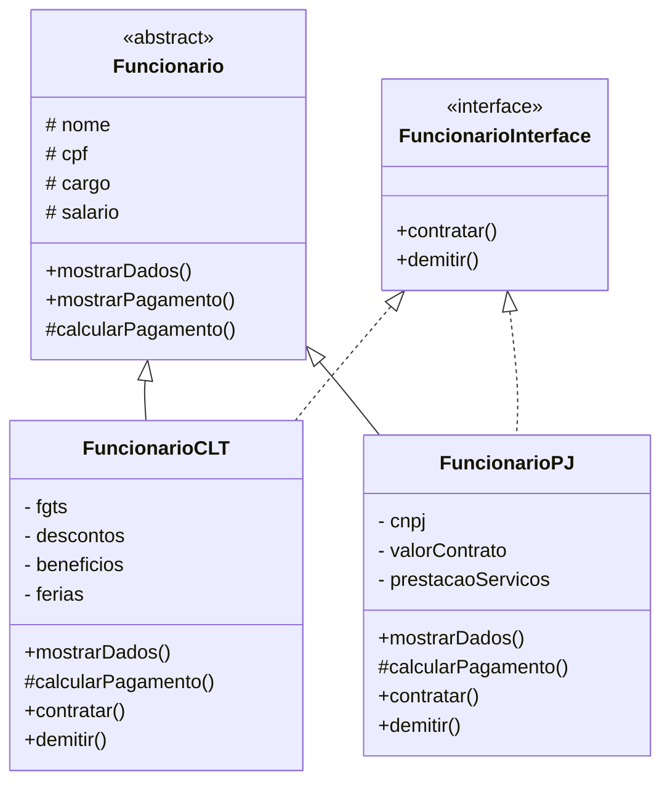

# EXERCÍCIOS DE APROPRIAÇÃO

Oque é uma interface?
* Contratos de comportamento que define quais métodos uma classe deve ter, mas não define como eles vão funcionar.

Qual a diferença entre classe abstrata e interface?
* Classe abstrata é um modelo base que pode ter código pronto, enquanto interface é um contrato que define métodos que a classe deve implementar.

Por que interfaces ajudam no trabalho em equipe?
* Porque definem regras claras, permitindo que cada pessoa trabalhe em partes diferentes do sistema sem atrapalhar o trabalho dos outros.

# PERGUNTAS:

Como interfaces ajudam ele a entender o sistema mais rápido?
* Porque mostram de forma clara quais métodos e regras uma classe deve seguir, facilitando a compreensão do sistema.

O que acontece se ele não seguir o contrato?
* A classe apresentará um erro, pois não cumpriu os métodos obrigatórios definidos pela interface.

 

